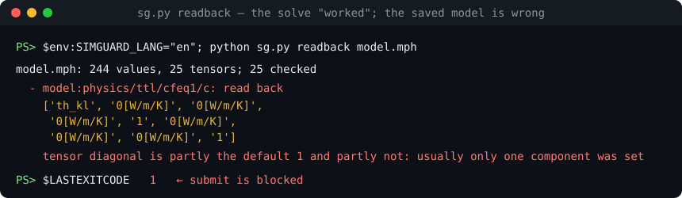

# simguard

[](https://github.com/tutiancheng1-max/simguard/actions/workflows/tests.yml)
[](LICENSE)


English | [简体中文](README.zh-CN.md)

**Catch the simulation that runs fine but was set up wrong, before an AI agent spends hours on it.**

An agent driving COMSOL set a thermal conductivity tensor as `diag(k, 1, 1)`: it wrote the one component it meant to and left the other two at the default `1 W/(m·K)`. The solve converged, the numbers looked plausible, and the thermal results of two papers became suspect before anyone noticed. Nothing in the log was wrong; only the saved model was.

simguard reads the saved model back before the job is submitted and stops it:



*Exit code 1, so `submit` refuses the run.*

`simguard` has two parts:

- **`simq`**: a single-machine solver queue. When several conversations and subagents share one machine, it schedules jobs by cores, memory and licenses, and solver processes keep running even if the agent that submitted them exits.
- **`sim-guard` skill**: a workflow and check scripts for Claude Code. It limits where the agent may work, reads back the saved model before submission, freezes pass/fail criteria, and requires the report to state which checks were not done.

The detailed docs inside the skill (under `skills/sim-guard/`) are currently in Chinese only.

## What it solves

The most expensive simulation errors are the ones where the model runs, the result looks reasonable, and it is still wrong. These errors fall into four general classes, each with its own checks. The full taxonomy is in [failure-modes.md](skills/sim-guard/references/failure-modes.md).

| Class | General form | Examples | Mechanism |
|---|---|---|---|
| A Setup | The saved model differs from what you think it is | Only one tensor component set; sweep parameter never written into the model; a switch that does not do what its name says | Read back the saved file and check it against declared expectations (`.mph` parsed directly, other solvers export JSON); built-in check for partially set tensors; response tests judge numerically whether an input actually has an effect |
| B Execution | The result was not produced by this run | Error but exit code 0; NaN in results; driver edited after submission | Log error markers, output freshness and finite-value checks; preflight receipt covers scripts, drivers, criteria and model |
| C Validation | The check cannot fail | Benchmark shares the model's bug; all mesh levels give identical results; conservation not closed | Validation must be independent of model code; `converged` and `sum_approx` result expectations |
| D Process | The workflow was bypassed | Thresholds changed after seeing results; copying from an old buggy script; bypassing the queue | Criteria frozen, hash checked at submit, report and collect; `DO_NOT_REUSE` markers and `sg.py taint` trace downstream runs; work-scope and queue receipts |

When a new error shows up, classify it using the steps at the top of failure-modes.md, then add a check that catches it automatically. That way the same class of error does not happen twice.

## Requirements

- Windows (`simq` uses Windows process and memory APIs; `sg.py` is cross-platform but has only been tested on Windows)
- Python 3.9+, no third-party dependencies
- [Claude Code](https://claude.com/claude-code), to load the skill
- Your own solvers and licenses; this repo contains no solver

## Install

**1. Configure the queue**

```powershell
Copy-Item simq\config.example.json simq\config.json
```

Set the cores, memory and license counts in `simq\config.json` to match your machine. With `require_preflight` set to `true`, production jobs must pass the checks first.

**2. Install the skill**

```powershell
Copy-Item -Recurse skills\sim-guard $HOME\.claude\skills\sim-guard
```

**3. Tell the skill where the queue is**

Set the environment variable `SIMQ_PY` to the absolute path of `simq.py`, or put a `simguard.project.json` with `simq_py` in the project root.

**Output language.** Messages from `sg.py`, `sweep.py` and `simq.py` follow your OS language (Chinese or English). Override with the environment variable `SIMGUARD_LANG=en`, `zh`, or `both` (both languages on each line).

**4. Configure project rules (optional)**

See [simguard.project.example.json](skills/sim-guard/assets/simguard.project.example.json):

| Field | Purpose |
|---|---|
| `simq_py` | Path to `simq.py`, relative to the config file |
| `readonly_paths` | Run directories may not be placed under these paths |
| `approved_templates` | When set, `derived_from` may only point inside these paths |
| `do_not_reuse_markers` | Scripts in a directory containing these filenames may not be reused |
| `forbidden_patterns` | Known-bad code patterns for this project |
| `readback_expect` | Readback expectations applied to every run in the project |
| `builtin_readback` | Set to `false` to turn off the built-in tensor check |
| `required_report_checks` | Extra checks the report must answer |

**5. Add the rule to the project's CLAUDE.md (recommended)**

```markdown
All long solves go through the sim-guard workflow and the simq queue; never start a solver directly.
When dispatching a subagent, fill in sim-guard's references/agent-brief.md and include it in the prompt.
```

## Usage

Ask for a simulation task in Claude Code and the skill triggers automatically. The agent follows this flow:

```powershell
python sg.py init runs\case1
# fill in gate.json and manifest.json
python sg.py freeze runs\case1
python sg.py submit runs\case1 --script run.ps1 --sw comsol --est 3
# after the solve finishes, fill in REPORT.md
python sg.py report runs\case1
```

You can also check existing files by hand:

```powershell
python sg.py readback model.mph            # built-in tensor check
python sg.py readback model.mph --list     # list all parameters, physics and material settings in the model
python sg.py scan path\to\drivers
python sg.py taint runs\old_run --reason "only one tensor component set"   # find every run derived from it
```

A readback expectation in `manifest.json` looks like this (run `sg.py readback <file> --list` to see the available keys):

```json
"readback": {
  "sources": {"model": "out/model.mph"},
  "expect": [
    {"select": "model:param/L", "op": "approx", "value": 3e-6, "rel": 1e-9},
    {"select": "model:physics/*/*/c", "op": "isotropic"}
  ]
}
```

## End-to-end tests

[examples/e2e.py](examples/e2e.py) runs very short cases on real solvers: the correct version must pass and a deliberately broken version must be blocked. It uses licenses, so run it through the queue while the machine is idle:

```powershell
python examples\e2e.py comsol --workdir D:\e2e\comsol --simq C:\path\simq.py
python examples\e2e.py lumerical --workdir D:\e2e\lumerical --simq C:\path\simq.py
```

## Parameter sweeps

For multiple cases or multiple stages, use `sweep.py`; see [references/sweep.md](skills/sim-guard/references/sweep.md):

```powershell
python sweep.py plan sweep.json
python sweep.py advance sweep.json --wait 540
python sweep.py collect sweep.json
```

Re-running does not resubmit. Each case reads back its own parameters; license problems and lost jobs are retried up to a limit, while other failures stop that case without affecting the rest.

## Limits

These checks reduce errors; they do not prove the model is correct.

- `.mph` global parameters, physics settings and material properties are parsed directly. Lumerical, Fluent and other solvers have no built-in parser; the agent has to export JSON and configure expectations for it.
- The built-in `no_partial_default` is a heuristic: a genuinely anisotropic tensor with a component that happens to equal 1 will be flagged, and must be listed in `readback.allow` with a reason.
- `manifest`, `gate` and the report are filled in by the agent. Whether `shares_code_with_model` is true and whether report evidence is reliable can only be seen as records by the scripts; a human or another agent needs to review them. Response-test numbers can be read from result files, but which file belongs to which run is still written by the agent.
- Empty `response_tests`, `switch_tests` and `literature` are treated as "nothing applies".
- Receipts are plain files. These checks guard against oversight and shortcuts, not deliberate forgery.
- Freezing criteria only prevents changing them after the run; it does not make the criteria themselves sound.
- Without a hook, an agent can still start a solver directly.
- Failure classification only looks at log text and can be wrong. `STALLED` is a hint, not proof that a job is stuck.
- `sweep.py advance` only moves to the next stage when a person or agent runs it again; it is not a resident service.

## Tests

```powershell
python -m unittest discover -s tests
```

The tests start an isolated dispatcher in a temp directory, leave any existing queue alone, and call no solver. `autostart` is only tested with `print`; no scheduled task is created.

## License

[MIT](LICENSE)
