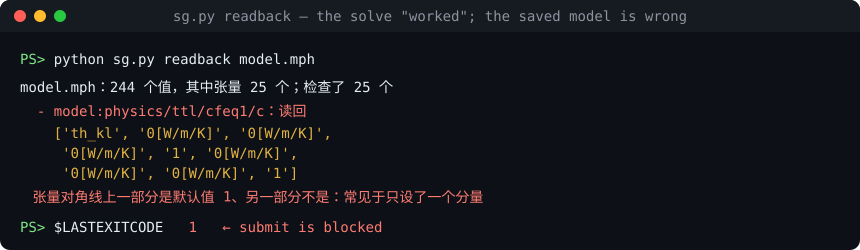

# simguard

[](https://github.com/tutiancheng1-max/simguard/actions/workflows/tests.yml)
[](LICENSE)


[English](README.md) | 简体中文

**在 AI agent 花几个小时算一个“能跑、但设错了”的仿真之前，把它拦下来。**

一个控制 COMSOL 的 agent 把热导率张量设成了 `diag(k, 1, 1)`：它只写了想写的那个分量，另外两个留在默认值 `1 W/(m·K)`。求解收敛了，数字看着也合理，等发现时两篇论文的热学结果都已经存疑。日志里没有任何错误，错的只是保存下来的模型。

simguard 在提交前读回保存的模型，直接拦下：



*退出码为 1，`submit` 拒绝提交这次运行。*

让 AI agent 跑长时间科学仿真时，少犯那些“算得出结果、但模型其实设错了”的错误。

`simguard` 由两部分组成：

- **`simq`**：单机仿真队列。多个对话和子 agent 共用一台机器时，按核数、内存和 license 排队，求解进程不依赖提交它的 agent。
- **`sim-guard` skill**：给 Claude Code 用的流程和检查脚本。它限定 agent 的工作范围，在提交前读回已保存的模型，冻结判据，并要求报告写明没做的检查。

skill 内部的详细文档（`skills/sim-guard/` 下）目前只有中文。

## 它解决什么问题

仿真最贵的错误是“模型能算、结果看起来合理，但其实不对”。这些错误按一般形式分成四大类，每类都有对应的检查。完整的分类见 [failure-modes.md](skills/sim-guard/references/failure-modes.md)。

| 大类 | 一般形式 | 例子 | 机制 |
|---|---|---|---|
| A 设置类 | 保存下来的模型和你以为的不一样 | 张量只设了一个分量；扫描参数没写进模型；开关名不副实 | 读回保存的文件并按声明的期望核对（`.mph` 直接解析，其他求解器导出 JSON）；内置检查所有张量是否只设了一部分；响应测试按数字判定输入是否真的起作用 |
| B 执行类 | 结果不是这次算出来的 | 出错但退出码为 0；结果里有 NaN；提交后又改了驱动 | 日志错误标记、产物新鲜度和有限值检查；preflight 回执覆盖脚本、驱动、判据和模型 |
| C 验证类 | 校验本身不可能失败 | 基准和模型带同一个错误；各级网格结果完全相同；守恒没闭合 | 校验必须独立于模型代码；`converged`、`sum_approx` 结果期望 |
| D 过程类 | 流程被绕过 | 看结果改阈值；从有错的旧脚本复制；绕过排队 | 判据冻结并在提交、报告、汇总时核对哈希；`DO_NOT_REUSE` 标记和 `sg.py taint` 追踪下游运行；工作范围和队列回执 |

遇到新的错误时，按 failure-modes.md 开头的步骤归类，再加一条能自动抓住它的检查。这样同一类错误不会第二次发生。

## 依赖

- Windows（`simq` 使用 Windows 的进程和内存接口；`sg.py` 跨平台，但目前只在 Windows 上测过）
- Python 3.9 以上，无第三方依赖
- [Claude Code](https://claude.com/claude-code)，用于加载 skill
- 你自己的求解器和 license，本 repo 不包含任何求解器

## 安装

**1. 配置队列**

```powershell
Copy-Item simq\config.example.json simq\config.json
```

把 `simq\config.json` 里的核数、内存和 license 数改成你的机器。`require_preflight` 设为 `true` 时，正式任务必须先通过检查。

**2. 安装 skill**

```powershell
Copy-Item -Recurse skills\sim-guard $HOME\.claude\skills\sim-guard
```

**3. 告诉 skill 队列在哪里**

设置环境变量 `SIMQ_PY` 为 `simq.py` 的绝对路径；或者在项目根目录放一个 `simguard.project.json`，写上 `simq_py`。

**4. 配置项目规则（可选）**

参考 [simguard.project.example.json](skills/sim-guard/assets/simguard.project.example.json)：

| 字段 | 作用 |
|---|---|
| `simq_py` | `simq.py` 的路径，相对于配置文件 |
| `readonly_paths` | run 目录不能放在这些路径下 |
| `approved_templates` | 设置后，`derived_from` 只能来自这些路径 |
| `do_not_reuse_markers` | 目录里有这些文件名时，不能复用其中的脚本 |
| `forbidden_patterns` | 项目已知的错误写法 |
| `readback_expect` | 对本项目所有运行都生效的读回期望 |
| `builtin_readback` | 设为 `false` 可关闭内置的张量检查 |
| `required_report_checks` | 报告必须多回答哪些检查 |

**5. 把规则写进项目的 CLAUDE.md（推荐）**

```markdown
长时间求解一律走 sim-guard 流程和 simq 队列，不要直接启动求解器。
派子 agent 时，把 sim-guard 的 references/agent-brief.md 填好放进 prompt。
```

## 用法

在 Claude Code 里提出仿真任务，skill 会自动触发。agent 走的流程如下：

```powershell
python sg.py init runs\case1
# 填写 gate.json 和 manifest.json
python sg.py freeze runs\case1
python sg.py submit runs\case1 --script run.ps1 --sw comsol --est 3
# 求解完成，填写 REPORT.md
python sg.py report runs\case1
```

你也可以手动检查已有的文件：

```powershell
python sg.py readback model.mph            # 内置张量检查
python sg.py readback model.mph --list     # 列出模型里所有参数、物理场和材料设置
python sg.py scan path\to\drivers
python sg.py taint runs\old_run --reason "张量只设了一个分量"   # 找出所有从它派生的运行
```

`manifest.json` 里的读回期望写法如下（可用的键先用 `sg.py readback <文件> --list` 查看）：

```json
"readback": {
  "sources": {"model": "out/model.mph"},
  "expect": [
    {"select": "model:param/L", "op": "approx", "value": 3e-6, "rel": 1e-9},
    {"select": "model:physics/*/*/c", "op": "isotropic"}
  ]
}
```

## 端到端测试

[examples/e2e.py](examples/e2e.py) 用真实求解器跑很短的算例：正确版本要走通，故意设错的版本要被拦下。它会占用 license，请在机器空闲时通过队列运行：

```powershell
python examples\e2e.py comsol --workdir D:\e2e\comsol --simq C:\path\simq.py
python examples\e2e.py lumerical --workdir D:\e2e\lumerical --simq C:\path\simq.py
```

## 参数扫描

多个算例或多个阶段时用 `sweep.py`，说明见 [references/sweep.md](skills/sim-guard/references/sweep.md)：

```powershell
python sweep.py plan sweep.json
python sweep.py advance sweep.json --wait 540
python sweep.py collect sweep.json
```

重复运行不会重复提交。每个算例都会读回自己的参数；license 问题和丢失的任务按上限重试，其他失败会停下，不影响别的算例。

## 能力边界

这些检查能减少错误，但不能证明模型正确。

- `.mph` 可以直接解析全局参数、物理场设置和材料属性。Lumerical、Fluent 等求解器没有内置解析，要由 agent 导出 JSON 再配置期望。
- 内置的 `no_partial_default` 只是启发式：真正各向异性、恰好某个分量等于 1 的张量会被误报，要在 `readback.allow` 里写明原因。
- `manifest`、`gate` 和报告里的内容由 agent 填写。`shares_code_with_model` 是否属实、报告证据是否可靠，脚本只能看到记录，需要人或另一个 agent 复核。响应测试的数字可以从结果文件读取，但哪个文件对应哪次运行仍由 agent 填写。
- `response_tests`、`switch_tests` 和 `literature` 留空时，脚本视为没有相关项。
- 回执是普通文件，这些检查防的是疏忽和偷懒，不防故意伪造。
- 判据冻结只防止运行后被修改，不能保证判据本身合理。
- 除非加 hook，否则 agent 仍有可能直接启动求解器。
- 失败分类只看日志文字，可能分错。`STALLED` 也只是提示，不代表任务一定卡死。
- `sweep.py advance` 要有人或 agent 反复运行才会推进下一阶段，它不是常驻服务。

## 测试

```powershell
python -m unittest discover -s tests
```

测试会用临时目录启动一个独立的调度器，不碰已有队列，也不调用任何求解器。`autostart` 只测试 `print`，不会真的创建计划任务。

## 许可证

[MIT](LICENSE)
